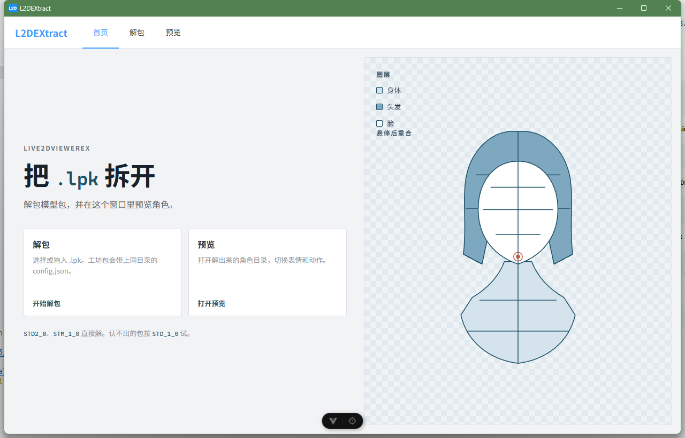
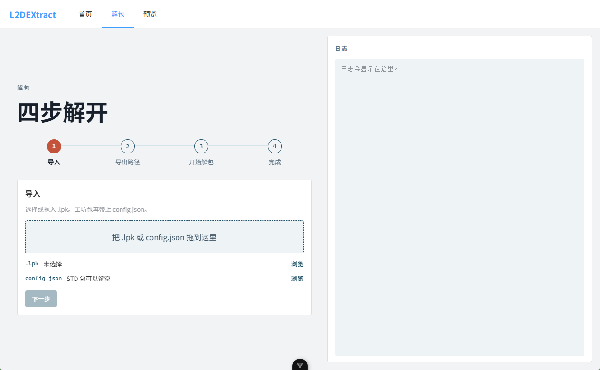
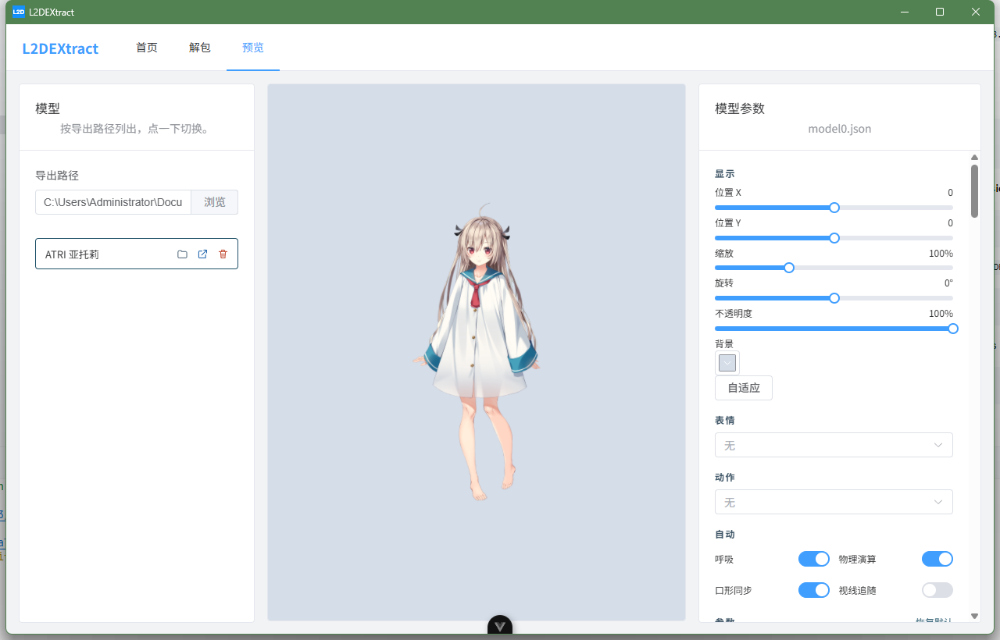

# L2DEXtract

[中文](README.md)

## Introduction

Extract Live2DViewerEX `.lpk` packages and preview the resulting Live2D models. The desktop app is built with Electron, Vue 3, and TypeScript.

Download and use it directly: https://github.com/zyozyu/L2DEXtract/releases/

- Extracts `STD2_0` and `STM_1_0`. Unknown or older packs are attempted as `STD_1_0`.
- Accepts a dropped `.lpk` and `config.json`. A `config.json` beside the `.lpk` is filled in automatically.
- Previews a model inside the app, or opens the same preview page in the system browser.

Home



Extract



Preview



## Commands

Requires Node.js `^22.18.0` or `>=24.12.0` (`22.18.0` recommended) and pnpm `11.7.0`.

### Setup

Print the Node.js and pnpm versions.

```sh
node -v
pnpm -v
```

Install pnpm `11.7.0` globally. **Skip this if that version is already installed.**

```sh
npm install -g pnpm@11.7.0
```

Except for installing pnpm, run the commands in `L2DEXtract-Electron`.

```sh
cd L2DEXtract-Electron
```

Install dependencies. `postinstall` then downloads Electron for the current platform.

```sh
pnpm install
```

### Development

Start the app in development mode. Code changes hot-reload.

```sh
pnpm dev
```

Preview the production build. Run `pnpm build` or `pnpm build-only` first.

```sh
pnpm preview
```

### Checks

Type-check with vue-tsc.

```sh
pnpm type-check
```

Run oxlint, then eslint, and auto-fix what they can.

```sh
pnpm lint
```

Format `src/` with Prettier.

```sh
pnpm format
```

### Build and package

Build without type-checking. Output goes to `out/`.

```sh
pnpm build-only
```

Type-check, then build.

```sh
pnpm build
```

Run `pnpm build`, then package a Windows NSIS installer with electron-builder. The installer is written to `L2DEXtract-Electron/release`.

```sh
pnpm dist
```

## Disclaimer

- This tool may only be used for **personal study and research**, and for backing up model files you are legally authorized to have.
- Do not use this tool to crack, steal, redistribute, commercially exploit, or otherwise infringe third-party intellectual property.
- Copyright and other intellectual property in the model assets and in Live2DViewerEX belong to their original authors and lawful rights holders.
- If misuse of this tool leads to any copyright dispute or civil or criminal liability, the user bears it alone. The author of L2DEXtract is not responsible.
